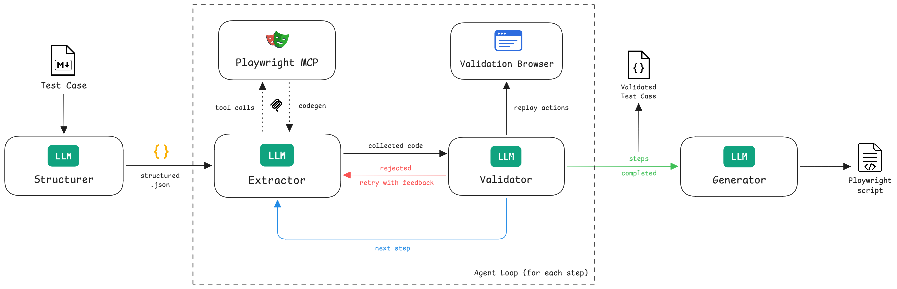

# TestPilot

TestPilot is a GenAI enabler for quick test script generation and automation. It is an LLM-powered application that, based on a specification of a test case (.md), generates a Playwright (TypeScript) test script, which can then be executed to receive a test report. It is currently in alpha: the full pipeline works end to end, and the next features are tracked in the roadmap.

The core idea: the LLM never writes test code from a static view of the page. It **drives a real browser** through [Playwright MCP](https://github.com/microsoft/playwright-mcp), one step at a time, and keeps only the code Playwright itself reports running. The whole script is then replayed in a second, clean browser before it is generated, so it contains only code that has already been proven against the live site.

What comes next is tracked in [ROADMAP.md](./ROADMAP.md).

## Application Architecture



The pipeline has four stages: the **Structurer** turns the markdown into a structured test case, the **Agent Loop** (Extractor, Playwright MCP and the Validator's semantic validation) works out the code for each step, **Script Validation** (the Validator and the Validation Browser) proves the whole script, sending a failing step back to the Agent Loop, and the **Generator** assembles the validated code into a test script.

## Domain Description

### Structurer

**Input**: Markdown file (.md) containing a test case specification

```markdown
# Add item to the shopping cart

urls = ["https://www.saucedemo.com/", "https://www.saucedemo.com/inventory.html"]

## Steps

1. Launch browser and navigate to url 'https://www.saucedemo.com/'
2. Verify that the Login Section is visible successfully
3. Enter the username 'standard_user' and the password 'secret_sauce'
...
```

- `Structurer`: Module responsible for receiving the input and prompting
    the LLM to convert it into a modular JSON structure: the test case is
    split into modules (one per page/URL), each with its execution steps

**Output**: The structured test case in JSON format, with no code yet

```json
{
    "name": "...",
    "modules": [
        {
            "url": "...",
            "description": "...",
            "execution_steps": [
                {
                    "step": "...",
                    "statements": []
                }
            ]
        }
    ]
}
```

### Agent Loop (for each step)

**Input**: The structured test case

Every step is extracted one at a time, in order, across all modules. The agent's browser stays open between steps, so each step starts from the state the previous steps left behind.

- `Extractor`: An LLM agent that performs the step in a live browser by
    calling Playwright MCP tools (find elements, click, type, verify, ...).
    Every successful tool call reports the exact Playwright code it ran
    (`codegen`). When done, the agent reports which of those lines belong
    to the step (`step_done`). It never writes code itself: a line
    Playwright MCP did not emit is rejected
- `Playwright MCP`: A Playwright MCP server running inside the application,
    reached over an in-memory MCP transport. It drives the agent's browser,
    which is a workspace: it also holds failed attempts and exploratory
    detours
- `Validator` (**semantic validation**): Each `step_done` report is judged
    straight away: the LLM is prompted to judge whether the code does what
    the step asked (for example, that it verifies the right message rather
    than any visible heading). On acceptance, it records a reason for each
    statement and the agent moves on to the next step. A rejection goes back
    to the agent with feedback, and the agent fixes the step in the same
    conversation, its browser still live, up to two times

**Output**: The test case with every step's statements filled in, not yet proven to run on their own

### Script Validation

**Input**: The test case with every step's statements

Once all steps are done, the whole script is validated in one replay.

- `Validation Browser`: A separate, clean Playwright browser that runs only
    accepted code. Its state is exactly what the generated script will
    produce
- `Validator` (**script validation**): Reset the Validation Browser and
    replay all steps back to back, as the script will run. Every action and
    assertion may wait up to 30 seconds, and each assertion is timed: one
    that needed longer than Playwright's 5-second default gets a `timeout`
    of twice what it took (see *Waiting for late content*). The first error
    (an element not found, a locator matching several elements, a failed
    assertion) ends the round and is mapped back to its step

If the replay fails at step N, that step is **re-extracted** in the Agent Loop with the failure as feedback, and only that step: the agent's browser is restored to the state before it by running the earlier steps' accepted code in a fresh session (see *Retry and reset*), the other steps keep their statements, and the whole script is validated again. A step the semantic validation still rejects once the agent's two repairs run out is re-extracted the same way. Every re-extraction spends one of 5 retries per run (`MAX_RETRIES` in `src/runtime/pipeline.ts`); when they run out, the run aborts. Once all steps are validated, the test case goes to the Generator.

**Output**: The validated test case in JSON format, saved to disk before generation

```json
{
    "name": "Login User with Incorrect Credentials",
    "modules": [
        {
            "url": "http://automationexercise.com",
            "description": "Home page where the user starts ...",
            "execution_steps": [
                {
                    "step": "Launch browser and navigate to url 'http://automationexercise.com'",
                    "statements": [
                        {
                            "code": "await page.goto('http://automationexercise.com');",
                            "reason": "Navigates the page to the requested URL ...",
                            "type": "action"
                        },
                        {
                            "code": "await page.getByRole('button', { name: 'Consent' }).click();",
                            "reason": "Dismisses the consent popup ...",
                            "type": "action"
                        }
                    ]
                },
                {
                    "step": "Verify that home page is visible successfully",
                    "statements": [
                        {
                            "code": "await expect(page.getByRole('heading', { name: 'AutomationExercise' })).toBeVisible();",
                            "reason": "Asserts the home page heading ...",
                            "type": "assertion",
                            "timeout": 12000
                        }
                    ]
                }
            ]
        }
    ]
}
```

`type` is derived from the code (an `await expect(...)` is an assertion), never asked of the LLM. `timeout` (milliseconds) appears only on an assertion that needed longer than Playwright's default; `code` stays exactly what Playwright MCP emitted.

### Generator

**Input**: The validated test case

- `Generator`: Module responsible for prompting the LLM to write the
    complete Playwright Test (`@playwright/test`) spec (header comment,
    import, test title, one comment per step) around the validated
    statements and fixed settings: the locale, and a test timeout when the
    statements take long to run (see *Waiting for late content*). The LLM
    also writes each assertion's measured timeout into its matcher, as the
    prompt marks it: `toBeVisible()` becomes
    `toBeVisible({ timeout: 12_000 })`. The result must parse and must
    contain every statement and setting unchanged and in order, a timed
    assertion with exactly its timeout added. A script that is not is written
    again once, with the LLM told why; a second failure fails the run, with
    the validated JSON already on disk

**Output**: The executable test script file

```typescript
/**
 * Login with incorrect credentials.
 *
 * Checks that a wrong email and password show an error message.
 */

import { expect, test } from '@playwright/test';

test.use({ locale: 'en-US' });

/** Verify that incorrect login credentials show an error message. */
test('Login user with incorrect credentials', async ({ page }) => {
  // Launch browser and navigate to url 'http://automationexercise.com'
  await page.goto('http://automationexercise.com');
  await page.getByRole('button', { name: 'Consent' }).click();

  // Verify that the home page is visible successfully
  await expect(page.getByRole('heading', { name: 'AutomationExercise' })).toBeVisible({ timeout: 12_000 });
  ...
});
```

## Requirements

### Functional
1. Accept a markdown test-case specification file as CLI input.
2. The Structurer converts the markdown into the structured test case via one LLM call.
3. For each execution step, in order, the Extractor performs the step in a live browser through Playwright MCP, using only an allowlisted set of tools, and reports the code lines that belong to the step. Only lines emitted by a code-generating tool during that step are accepted.
4. The Validator judges each step's code via an LLM call as the agent reports it; a rejection is returned to the agent, which fixes it in the same conversation up to two times. Once every step is extracted, the Validator replays the whole script in a freshly reset Validation Browser, back to back, timing each assertion and giving one that needed longer than Playwright's default a measured `timeout`.
5. A step that fails the replay, or that the semantic validation still rejects after the agent's repairs, is re-extracted with the failure as feedback, from the agent's browser restored to the state before the step; the other steps keep their statements. A run may re-extract at most 5 times (`MAX_RETRIES`); then it aborts with a `ValidatorError` (`STEP_VALIDATION_FAILED`). A malformed report, or one naming a line Playwright MCP never ran, goes back to the agent like a rejection; one still invalid once the agent's repairs run out, like any other Extractor failure (no completion within `maxTurns`), aborts the run with an `ExtractorError`.
6. Popups (cookie-consent banners, newsletters, surveys) are dismissed in the step that makes them appear, as ordinary validated statements. There is no site-specific or injected overlay handling.
7. The Generator turns the validated test case into a single executable Playwright Test (TypeScript) spec, using the `page` fixture, with every validated statement copied unchanged but for its measured timeout. A script that drops or alters a statement or does not parse aborts the run with a `GeneratorError`.
8. The CLI runs the full pipeline as a single command: `testpilot generate <path.md>` (after `npm link`; `npm run --silent testpilot -- generate <path.md>` without it, `--silent` keeping npm's banner off stdout). Playwright is the only target framework. Flags change one run: `--headed` shows the browser the agent drives (the validation browser stays headless), and `--out`, `--max-turns`, `--locale` and `--log-level` override `scriptsDir`, `maxTurns`, `locale` and `logLevel`, beating every other settings source; `--out` is relative to the working directory, and an invalid flag value is a configuration error (exit status 2) that names the flag. Results go to stdout and progress to stderr: a successful run prints `spec:`, `test case:` and `log:` paths, and `--json` prints one JSON object instead (`GenerateResult`: `status`, `exitCode`, absolute `spec`, `testCase` and `log` paths, and on failure `error` with `code`, `hint`, `type`, `stage`, `step` and `message`), for every failure after the arguments parse. Every `generate` failure after the arguments parse has one of 21 stable error codes (`UPPER_SNAKE_CASE`, e.g. `INPUT_NOT_FOUND`, `STEP_OUT_OF_TURNS`), each with a fixed exit code and a static hint, catalogued in `src/error-codes.ts` (`ERROR_CODES`). `errorCodeFor` classifies a failure by walking its `cause` chain, the most specific match winning (a `BrowserLaunchError` inside an `McpError` is `BROWSER_LAUNCH_FAILED`); every `PipelineError` carries its code, set where it is thrown. Without `--json`, the final stderr error line is `CODE: message`, followed by a `Hint: ...` line; both are logged whatever the log level. The exit status is `0` on success, `1` when the test case fails to generate and `2` for a setup problem: an invalid configuration, a missing input file or API key, an HTTP 401, 403 or 404 from the LLM service, or a Chromium that cannot launch. The pipeline updates a `RunProgress` (stage and step) as it goes, which is how a failure names where it happened, and whenever nothing has been logged for 10 seconds (checked every 5, so no gap exceeds 15), a watchdog logs `Waiting for <stage> to finish: step <i> of <n>, "<step>" (<s>s)` (the step number and step only while a step is extracted, from the `stepNumber` and `stepCount` it also tracks) from it, whatever the log level, so a long run never looks stuck.
9. The pipeline writes the generated script to the scripts folder (`scriptsDir`, resolved against the project root; `testpilot/` by default) and the validated JSON to `.testpilot/tests/`, both named after the input file (e.g. `examples/automation/test_x.md` -> `testpilot/test_x.spec.ts` and `.testpilot/tests/test_x.json`). The JSON records the input it came from as `source` (relative to the project root); a run whose JSON already exists with another `source`, an input with the same name in another folder, stops before it starts with `OUTPUT_CONFLICT` (exit `2`), so it never overwrites another test case's outputs. Before that check, a run reserves its outputs with a lock file next to the JSON (`.testpilot/tests/<stem>.json.lock`, recording its process and input), held until both are written: a run that finds the lock held by a run still going stops with `OUTPUT_CONFLICT` too, and one left by a run that stopped is taken over. The JSON is written before generation, so a generation failure never loses it. Each run also writes its log lines (the same as stderr, without colour) to a file of its own, `.testpilot/logs/<YYYY-MM-DD_HH-MM-SS>-<stem>.log`, created before the run and never shared: a run of the same input that started in the same second gets `_2`, `_3`, … after the time; the log's path is the first and the last line logged. A log file that cannot be created is a warning: the run goes on without it, and reports `log` as `null` (`(none)` without `--json`). The input path resolves against the working directory, the outputs against the project root.
10. The LLM provider is selected by `llmProvider` (`TESTPILOT_LLM_PROVIDER`): `azure_openai`, the only provider for now and the default. The mock provider is a test double, not a provider a run can select.
11. All three browsers (Playwright MCP's, the Validation Browser and the generated script's) use the same locale, so locators found by their text match at run time.
12. `testpilot init --skills[=<agent>] [-g]` installs the bundled agent skill (`skills/testpilot/`, in the Agent Skills format) by copying it over any existing `testpilot` skill folder, so files removed from the source are removed from the copy. The destination is `.agents/skills/testpilot/` (no value, or `agents`), `.github/skills/testpilot/` (`copilot`) or `.claude/skills/testpilot/` (`claude`) in the project, and `~/.agents/skills/testpilot/`, `~/.copilot/skills/testpilot/` or `~/.claude/skills/testpilot/` with `-g`. Without `-g` it runs as part of `init`: the skill is installed first, whatever the checks then say (so they compare the copy just installed, not the one it replaced), the checks run and print, and `.testpilot/` is written only if they pass (exit status 2 if a check other than the LLM settings failed). With `-g` only the user copy is installed, and the project is neither checked nor changed. `-g` without `--skills` and an unknown agent are usage errors (exit status 2).
13. `testpilot doctor` also compares each installed copy of the skill (the six destinations above) with the bundled one, file by file: the same relative paths with byte-equal contents. A copy that differs (`<path> is outdated`), from an older testpilot or edited by hand, is a warning (not a failure, so the exit status is unchanged) whose fix is the `testpilot init --skills ...` command that replaces it; a copy that matches is an `ok` line; with no copy installed there is no line.

### Non-functional
1. TypeScript, run directly by Node.js ≥24 (no build step), `npm`-only dependency management.
2. `strict` TypeScript with every function's return type declared; JSON contracts are zod schemas.
3. Code passes `tsc`, the repo's ESLint configuration (type-aware, TSDoc on exported APIs) and Prettier (print width 88) with zero errors.
4. Secrets are sourced only from `TESTPILOT_` environment variables (the shell, `.env` or `.env.local`), never from `.testpilot/config.json` and never hardcoded.
5. No out-of-band authentication: a page behind a login is reachable only if the test case's own steps log in.
6. Generated scripts must pass `npx playwright test` against the live site they were generated from, for the demoed examples.
7. Each stage is unit-testable offline via the mock LLM provider and a fake MCP server, with no live network or LLM calls.
8. Logging goes through the application logger (not ad hoc `console` calls), level controlled by `logLevel` (`TESTPILOT_LOG_LEVEL`), with clear per-stage log lines.
9. Single-user local CLI tool; no persistence layer or multi-tenant concerns in scope.
10. The application runs Playwright MCP in-process, and fails at startup with a clear error if it does not offer every allowlisted tool.

## Design Decisions

### Collect, never write

The Extractor's LLM does not author Playwright code. It drives the browser, and Playwright MCP reports the code each successful action ran, which is the same generator Playwright's own `codegen` uses. The agent's only job at the end of a step is to *select* which of those lines belong to it, leaving out failed attempts and detours. A line that was never emitted is rejected, which is also the safety boundary around running code in the Validation Browser.

Only tools whose emitted code is a self-contained test line are collectable (`COLLECTABLE_TOOLS` in `src/extractor/mcp/constants.ts`): navigation (including back), click, hover, drag, type, fill, select, key presses, and the `browser_verify_*` assertions. Other tools (find, snapshot, evaluate, waits, screenshots, resizing, file uploads, dialogs) still help the agent explore, but their code is never collected: they either emit no code, do not act on the page, only wait in the agent's browser, or emit code that depends on a variable from an earlier line. A wait the agent reports anyway is left out of the step rather than failing it. Narrating comment lines in a tool's code (such as `// Press Tab`) are not statements.

TypeScript is the one codegen language every Playwright MCP tool honours: tools outside Playwright's code generator emit hard-coded TypeScript whatever `codegen` says. The application, the Validation Browser and the generated script are all TypeScript, so the language a tool emits is never a reason to withhold its code.

Two traits of that generator show up in the scripts:
- It prefers test-id attributes (`data-testid`, `data-test-id`, `data-test`) when the element has one.
- It shortens long text (over 30 characters) to a word-bounded prefix, e.g. `getByText('Your email or password is')`. The full text was checked against the live page during extraction, so the Validator accepts the prefix.

### Two browsers

The Playwright MCP browser is the agent's workspace and holds whatever the agent did while exploring. Playwright MCP also waits briefly after every action, and that wait is not in the emitted code. Code that works there is therefore not yet known to work on its own.

The Validation Browser is the contract: plain Playwright running nothing but accepted code, each statement compiled into a function of `page` and `expect` only. The whole script is replayed from a fresh context, back to back, so it reproduces both the state the generated script will see and its timing. Both browsers launch Chromium with the same arguments, so a page behaves the same in each.

### Waiting for late content

Some pages render their content well after loading, or after a click (an OutSystems app such as `https://appsmobileqms.nos.pt/WOO_MOB/Prelogin` takes about 9 seconds to show a screen). Extraction hides this: Playwright MCP's `browser_verify_*` tools check the page once without waiting, but the agent's own turns take seconds, so the content is usually there by the time it asserts. The agent cannot reliably tell that content was late; the script, running statement after statement, would see it late every time.

The generated script must run in any Playwright project, so every wait it needs is in the script itself, and is measured rather than guessed:
- **Actions need nothing.** In Playwright Test, actions (`click`, `fill`, `goto`, ...) wait for their element with no time limit but the test's, so they never carry a timeout.
- **Assertions are timed in the replay.** The Validation Browser lets every assertion wait up to 30 seconds (Playwright MCP's own limit on `browser_wait_for`) and times it. One that passed after more than half of Playwright's 5-second default gets a `timeout` of twice what it took, rounded up to whole seconds; across rounds, an assertion keeps the largest. Content still missing after 30 seconds is a failure.
- **The Generator writes it into the matcher**: the prompt shows the statement with a `[timeout: 18_000]` marker, the LLM adds the option, and the verbatim check accepts the statement only if, without that option, it is the validated code and the value is the measured one. Statements are compared token by token, so the LLM may wrap one across lines or comment it. For example, `await expect(page.getByText('Produtos WOO')).toBeVisible({ timeout: 18_000 });`: one line per assertion, no wait statement before it, and no extractor round spent on late content.
- **The test timeout is measured too.** The successful replay runs the whole script from a fresh context, back to back, so its duration is the script's run time. When twice that exceeds Playwright's default 30 seconds, the Generator pins `test.setTimeout(...)` (rounded up to 10 seconds) as the first line of the test.

The agent may still use `browser_wait_for` to wait in its own browser, but its line never goes into the script.

### Retry and reset

To re-extract a step, the agent's browser must be in exactly the state the script is in before that step, including a consent banner it had already dismissed. Playwright MCP gets a fresh session (a new in-process server and a newly launched browser, so an empty profile), and the application then runs the earlier steps' accepted code on that session's page itself, back to back, as the replay does. This works because the application creates the browser context it hands to Playwright MCP, and Playwright MCP adopts the context's pages as its tabs. The state the URL alone does not carry (a chosen product, a filled form, a login) is restored with it, so the agent continues from a live page as on its first attempt.

If that restore fails at an earlier step's statement, that step's code is broken: it is re-extracted first (spending a retry), then the step that was being restored for.

### The Generator only assembles

Every statement was proven against a live browser, and letting an LLM rewrite them would discard that proof. The LLM writes everything around them (comments, the import, the test title, step comments) and adds only the measured timeouts, and a deterministic check rejects the script if any validated line or setting is missing, changed or out of order, or a timeout is missing, wrong or added where none was measured.

### Locale

Sites translate their text by the browser's `Accept-Language`, and most locators are text-based. The `locale` setting (`TESTPILOT_LOCALE`) sets the locale of all three browsers: it is used for the context handed to Playwright MCP and for the Validation Browser's context, and pinned into the generated script by `test.use({ locale })`.

### Playwright MCP version

`@playwright/mcp` is pinned in `package.json`, and an `overrides` entry makes it use the same Playwright as `@playwright/test`, so everything shares one install and one browser build. The tool surface changes between releases, so the application checks at startup that every allowlisted tool is offered, turning an upstream change into an immediate, named failure. `browser_run_code_unsafe` (arbitrary code in the server process) and `browser_close` (would end the session the pipeline owns) are never exposed.

## Playwright MCP Server

The application runs Playwright MCP itself (`createConnection` from `@playwright/mcp`, connected over an in-memory transport); there is no server to start. Each session gets a freshly launched Chromium (headless, or headed with `generate --headed`), whose context (locale from the `locale` setting, see *Locale*) is handed to the server: a fresh profile per session, so consent banners reappear every run and the retry reset works. The application closes that browser with the session, since Playwright MCP leaves a browser it launched itself running when its server closes.

The server's configuration is built in code (`mcpConfig()` in `src/extractor/mcp/server.ts`):

| Configuration key | Why it matters |
|---|---|
| `codegen: "typescript"` | Makes every tool result report the TypeScript statement it ran, which is what the Extractor collects. |
| `capabilities: ["testing"]` | Adds the `browser_verify_*` assertion tools; without them a verification step has nothing to collect. |
| `browser.isolated: false` | Use the context the session is given rather than open another one. |
| `outputDir` | `.testpilot/.playwright-mcp` under the project root, as an absolute path: Playwright MCP resolves a relative one against the working directory, which may be a project subfolder. |

## Known Limitations

- **Errors surface late.** A step's code is replayed only once every step is extracted (or when a restore runs into it), so an early step's error costs the extraction of the steps after it, and a fix that changes the flow can cost more rounds.
- **A wrong assertion is slow to fail.** The replay lets every assertion wait up to 30 seconds, so an assertion on something that never appears takes that long to fail validation.
- **Timeouts reflect the run that generated the script.** An assertion's timeout and the test timeout allow twice what was measured in one replay; a site that is slower than that on another day still times out. A pinned `test.setTimeout` also overrides a higher timeout set in the user's own Playwright config.
- **Five retries per run, none for Extractor failures.** Every re-extraction spends one, whether a replay failed, the semantic validation still rejected a step after the agent's repairs, or a restore broke at an earlier step; an Extractor failure (running out of turns, still reporting code MCP never ran after the agent's repairs) aborts the run immediately.
- **Single-line statements.** Collected code is split line by line, so a tool whose code spans several lines (`browser_verify_list_visible`'s aria snapshot) is withheld from the agent.
- **One locale per run.** The Playwright MCP locale is fixed when its session starts, so a run covers one locale.
- **Cost and latency.** Each step is its own agent conversation of several tool calls, plus a Validator call.
- **Non-determinism.** Replay proves each statement works; it does not guarantee the same locator is chosen on every run.

## Repository Structure

```
docs/
├── images/                         # images for documentation
├── APP_DESCRIPTION.md              # this document
└── ROADMAP.md                      # what is planned next
examples/                           # sample test-case markdown inputs, grouped by
|                                     target site (e.g. examples/automation/)
output/                             # gitignored; this repo's scriptsDir is output/testpilot/
|                                     (generated specs)
skills/testpilot/                   # the agent skill: SKILL.md + references/, copied by
|                                     testpilot init --skills
.testpilot/                         # config.json (committed); logs/, tests/ and
|                                     .playwright-mcp/ are gitignored
prompts/                            # one template per LLM call
├── structurer.md
├── extractor.md
├── validator.md
└── generator.md
src/
├── cli/
|   ├── cli.ts                      # the testpilot program: commands and exit
|   |                                 codes
|   ├── config.ts                   # testpilot config list, config set-azure-openai
|   ├── doctor.ts                   # testpilot doctor: the setup checks
|   ├── errors.ts                   # CliExit, UsageError, LogFolderError, fail(),
|   |                                 failWithCode(), errorCodeFor(), exitCodeFor(),
|   |                                 loadSettingsOrFail()
|   ├── generate.ts                 # testpilot generate, the --json result
|   ├── init.ts                     # testpilot init: creates .testpilot/, installs
|   |                                 the skill with --skills
|   └── skills.ts                   # skill destinations, installSkill(), checkSkills()
├── extractor/
|   ├── mcp/
|   |   ├── constants.ts            # timeouts, allowed and collectable tools,
|   |   |                             emitted-code pattern
|   |   └── server.ts               # PlaywrightMCP: in-process server and
|   |                                 in-memory client; mcpConfig()
|   ├── agent.ts                    # StepAgent: per-step tool-calling loop,
|   |                                 collects the reported statements
|   ├── service.ts                  # Extractor: runs one step
|   └── utils.ts                    # statement compiling, prompt context, checks
├── generator/
|   ├── service.ts                  # Generator: LLM assembly
|   └── utils.ts                    # settings, prompt steps, verbatim check
├── llm/                            # LLM provider abstraction
|   ├── protocol.ts                 # LLMProvider interface (completion and
|   |                                 tool-calling conversation)
|   ├── factory.ts                  # getLlmProvider(settings)
|   ├── retry.ts                    # rate-limit retry wrapper applied to every
|   |                                 provider
|   └── provider/                   # concrete LLMProvider implementations
|       ├── mock.ts                 # test double for the suite
|       ├── azure-openai.ts
|       └── openai-chat.ts          # Chat Completions tool-calling conversation
├── model/                          # shared JSON-contract schemas
|   └── test-case.ts                # TestCase, Module, ExecutionStep, StepStatement
├── runtime/
|   ├── exceptions.ts               # PipelineError + per-stage subclasses
|   └── pipeline.ts                 # runPipeline() and the extract-then-validate
|                                     loop
├── structurer/
|   └── service.ts                  # Structurer: markdown -> structured JSON
├── validator/
|   ├── browser.ts                  # runStatements (ceiling, timing) and
|   |                                 ValidationBrowser: replays accepted code
|   ├── service.ts                  # Validator: semantic check + whole-script
|   |                                 replay
|   └── utils.ts                    # failure feedback, measured timeouts
├── config.ts                       # zod Settings + configureLogging()
├── error-codes.ts                  # ERROR_CODES: stable error codes, exit codes, hints
├── logger.ts                       # levelled, coloured stderr logger, per-run log
|                                     file, lastLineAt()
├── main.ts                         # the testpilot executable: runs the CLI
└── prompt-loader.ts                # loadPrompt / renderPrompt
test/                               # Vitest suite mirroring src/
playwright.config.ts                # runs the generated specs in output/testpilot/
```
