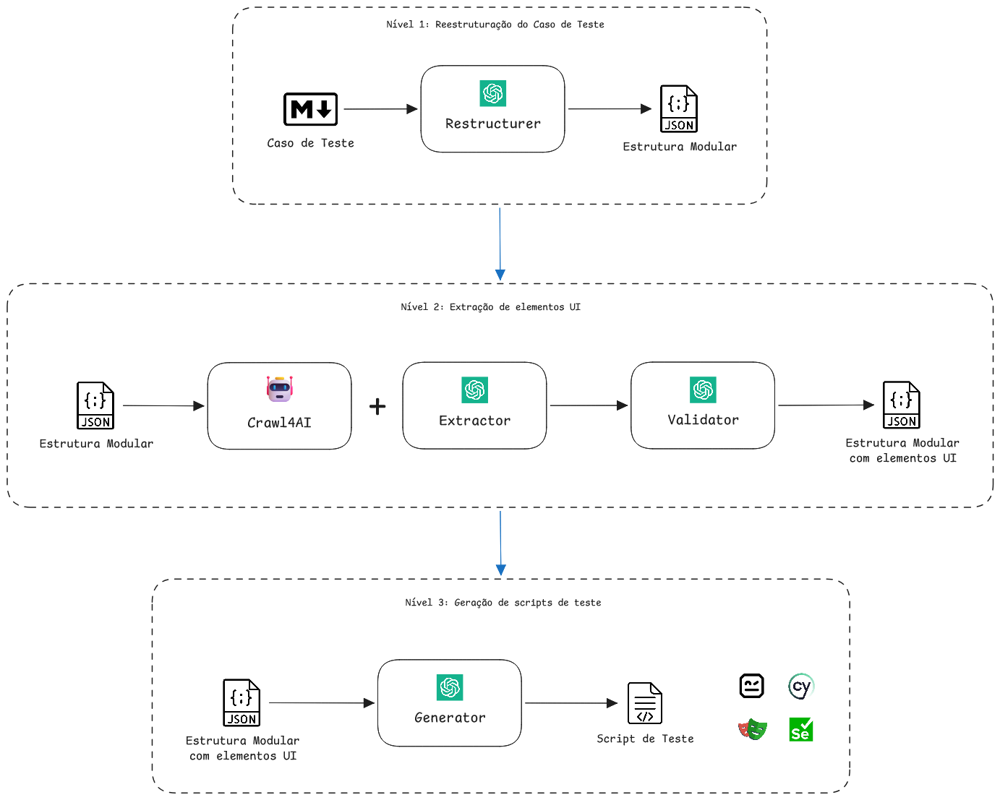

# GenAI-Test-Script-Automation

This project is a proof of concept with the objective of exploring and designing a GenAI enabler for quick test script generation and automation. This enabler will be a LLM-powered application that, based on a specification of a test case (.md), will generate a test script file built using a testing framework (e.g., .js, .ts, .robot, etc.), which can then be executed to receive a test report.

## Application Architecture (Prototype)



> **Note**: The diagram above labels the Level 1 module "Restructurer". This document and the codebase standardize on **Structurer** instead.

## Domain Description

### Level 1

**Input**: Markdown file (.md) containing a test case specification

- `Structurer`: Module responsible for receiving the input and prompting
    the LLM to convert and generate to JSON modular format

**Output**: A modular structure of the test case in a JSON format

```json
"name": "...",
"modules": [
    {
        "url": "...",
        "description": "...",
        "execution_steps": [
            {
            "step": "...",
            "extracted_data": []
            }
        ]
    }
]
```

### Level 2

**Input**: Level 1 output

For each module (url) inside the JSON test case:

- `Crawler`: A web crawl tool to extract data from the url
- `Extractor`: Module responsible for prompting the LLM to choose the 
    necessary data to extract for the test case
- `Validator`: Module responsible for prompting the LLM to verify
    if all the data collected is correct for the test case

**Output**: A modular structure of the test case in a JSON format 
    containing also HTML extracted data

```json
"name": "...",
"modules": [
    {
        "url": "...",
        "description": "...",
        "execution_steps": [
            {
                "step": "...",
                "extracted_data": [
                    {
                        "type": "...",
                        "request_description": "...",
                        "identifier_type": "...",
                        "identifier_tracking": "..."
                    }
                ]
            }
        ]
    }
]
```

### Level 3

**Input**: Level 2 output

- `Generator`: Module responsible for prompting the LLM to generate
    a test script file in the chosen framework

**Output**: The executable test script file

## Requirements

### Functional
1. Accept a markdown test-case specification file as CLI input.
2. Structurer converts the markdown into the Level 1 JSON via an LLM call.
3. For each module URL, the Crawler retrieves page content via Crawl4AI, restricted to publicly accessible, non-authenticated pages.
4. Extractor selects, per execution step, the UI elements needed via an LLM call.
5. Validator checks each extracted identifier against the crawled content via an LLM call before it's accepted into the Level 2 output.
6. Generator turns the validated Level 2 JSON into a single executable Robot Framework script using Browser Library keywords.
7. The CLI exposes a `--framework` flag; only `robot` is functional in this PoC (`playwright`/`cypress` remain documented, not implemented).
8. The pipeline persists the Level 1 JSON, Level 2 JSON, and the generated script as separate, inspectable files per run.
9. The LLM provider is selectable via `LLM_PROVIDER` (`mock`/`anthropic`/`openai`/`azure_openai`); all four are implemented, though only `azure_openai` (this PoC's primary target) and `mock` (offline development/testing) have been exercised against a real endpoint so far — `anthropic`/`openai` are implemented and unit-tested but not yet run against real credentials.
10. On a validator failure, the pipeline retries extraction once with feedback, then aborts with a clear error.

### Non-functional
1. Python ≥3.13, `uv`-only dependency management, no `pip`.
2. All functions/methods carry full type hints; JSON contracts are Pydantic v2 models.
3. Code passes the repo's ruff configuration (line-length 88, Google docstrings, double quotes) with zero errors.
4. Secrets are sourced only from environment variables/`.env`, never hardcoded; `.env` stays gitignored.
5. No authentication/session handling — crawling is scoped to public pages (documented limitation for this PoC).
6. Generated Robot Framework scripts must parse cleanly (`robot --dryrun`) for the demoed example(s).
7. Each pipeline stage is independently unit-testable via a mock LLM provider, with no live network/LLM calls required.
8. Logging uses the standard `logging` module (not `print`), level controlled by `LOG_LEVEL`, with clear per-stage log lines.
9. Single-user local CLI tool; no persistence layer or multi-tenant concerns in scope.
10. Script execution, test-report generation, and non-Robot-Framework generators are explicitly out of scope for this PoC (future roadmap items only).

### Supported Test Frameworks

- Robot Framework: implemented in this PoC (via Browser Library)
- Playwright: documented future target, not implemented in this PoC
- Cypress: documented future target, not implemented in this PoC
- Selenium: documented future target, not implemented in this PoC

## Repository Structure

```
docs/
├── images/                         # images for documentation
└── PLAN.md                         # Project Planning and roadmap
output/                             # gitignored, per-run generated artifacts (JSON + script)
resources/
├── examples/                       # sample test-case markdown inputs for demos
└── prompts/                        # one template per pipeline stage
|   ├── structurer.md
|   ├── extractor.md
|   ├── validator.md
|   └── generator_robot.md
src/
├── crawler/                        # Level 2 (Crawl4AI wrapper)
|   └── service.py                  # Crawler, CrawlResult
├── extractor/                      # Level 2
|   └──service.py
├── generator/                      # Level 3
|   ├── service.py
|   └── frameworks.py               # TestFramework -> prompt template registry
|                                     (robot only, for now)
├── llm/                            # LLM provider abstraction
|   ├── protocol.py                 # LLMProvider protocol
|   ├── factory.py                  # get_llm_provider(settings)
|   └── provider/                   # concrete LLMProvider implementations
|       ├── mock.py
|       ├── azure_openai.py
|       ├── openai.py
|       └── anthropic.py
├── model/                          # shared JSON-contract schemas (cross-stage)
|   ├── enums.py                    # ElementType, IdentifierType, TestFramework
|   ├── test_case.py                # 
|   └── extracted_data.py           # Level 2: ExtractedData, ExecutionStepWithData,
|                                     ModuleWithData, TestCaseWithData
├── structurer/                     # Level 1
|   └── service.py
├── validator/                      # Level 2
|   ├── service.py
|   └── models.py                   # ValidationResult
├── cli.py                          # typer app: `generate-script` command
├── config.py                       # pydantic-settings Settings + configure_logging()
├── exceptions.py                   # PipelineError + per-stage subclasses, ConfigurationError
├── main.py                         # CLI entrypoint wiring
├── pipeline.py                     # orchestrator: Level1 -> Level2 (per-module loop) -> Level3
└── prompt_loader.py                # load_prompt / render_prompt
test/                               # pytest suite mirroring the modules above
```

## Roadmap

- [x] **M0 — Scaffolding**: dependencies added to `pyproject.toml` (`pydantic`, `pydantic-settings`, `python-dotenv`, `openai`, `crawl4ai`, `typer`; dev: `pytest`, `pytest-mock`, `robotframework`, `robotframework-browser`), `config.py` (incl. logging setup), prompt loader + structurer template stub (the other stages' templates are added per-milestone as each service is built), test scaffolding, `.gitignore` update for `output/`.
- [x]  **M1 — Structurer (Level 1) against Azure OpenAI**: LLM provider abstraction, Level 1 models, Structurer service + prompt. Demo: run against `LLM_PROVIDER=mock` (offline) and `LLM_PROVIDER=azure_openai` (real), both produce valid Level 1 JSON.
- [ ] **M2 — Crawler + Extractor + Validator (Level 2)**: Crawl4AI wrapper, Level 2 models, Extractor + Validator services and prompts. Demo: Level 1 -> Level 2 against a real public page, producing real extracted and validated element locators.
- [ ] **M3 — Generator (Level 3, Robot Framework)**: Generator service + prompt targeting Browser Library keywords. Demo: a hand-authored Level 2 JSON fixture produces a `.robot` file that passes `robot --dryrun`.
- [ ] **M4 — CLI + end-to-end wiring**: `pipeline.py`, `cli.py`, `generate-script` entry point, a worked example under `examples/`. Demo: one CLI run against a real page, fully live (Azure OpenAI + Crawl4AI), producing a script the reviewer runs manually with `robot`.
- [ ] **M5 (stretch, future)**: script execution + report ingestion, Playwright/Cypress generators, authenticated-page support, optional integration test suite.
